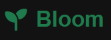

# BLOOM - Landing page --- 

Questa repository contiene il codice sorgente di una landing pare, sviluppata per **BLOOM**. La piattaforma è progettata per accogliere il cliente, presentare l'azienda e i servizi offerti.

---

> **Stato del progetto:** ultimato, aggiornamenti in arrivo. Questo file viene aggiornato a mano a mano che il progetto viene realizzato. Consulta la relativa sezione per vedere lo stato di queste ultima.


## Indice
- [Funzionalità](#funzionalità)
- [Tecnologie Utilizzate](#tecnologie-utilizzate)
- [Come Eseguire il Progetto Locale](#come-eseguire-il-progetto-locale)
- [Struttura del progetto](#struttura-del-progetto)
- [Architettura, Responsive Design e Media Query](#architettura-responsive-design-e-media-query)
- [Albero del dom](#albero-del-dom)
- [Come funziona](#come-funziona)
- [Convenzioni di codice](#convenzioni-di-codice)
- [Aggiornamenti](#aggiornamenti)
- [Realizzato da](#realizzato-da)


### Funzionalità

L'applicazione offre un'interfaccia moderna e minimale, progettata per garantire un'esperienza utente fluida e intuitiva. Tra le principali caratteristiche tecniche e interattive troviamo:

- **Navigazione Dinamica Sticky Header**: L'intestazione della pagina monitora lo scroll dell'utente, modificando lo stile e compattendosi automaticamente quando si scorre verso il basso per ottimizzare lo spazio visivo.
- **Modale Interattiva per Preventivi**: Un sistema di overlay centralizzato accessibile tramite pulsanti dedicati (`.quote`), completo di un modulo di contatto validato (`#quoteForm`), opzioni di chiusura multiple (pulsante dedicato, click sull'esterno o tasto `Escape`) e notifiche di invio.
- **Responsive Design Mobile-First**: Layout flessibile e adattivo che scala perfettamente da dispositivi mobili a schermi desktop, garantendo leggibilità e usabilità a ogni risoluzione.
- **Animazioni CSS Staggered**: Transizioni fluide ed effetti di entrata a cascata (`fadeInUp`) applicati alle schede delle sezioni *Works* e *Services* tramite selettori avanzati e ritardi calibrati.
- **Supporto Dark Mode**: Struttura predisposta per l'alternanza dei temi cromatici, che bilancia tonalità scure e chiare esaltando il colore brand primario (verde HSL).

## Tecnologie Utilizzate

- **HTML5**: Strutturazione semantica dell'interfaccia utente.
- **CSS3**: Styling moderno e layout responsive.
- **JavaScript (ES6+)**: estione dello scorrimento dell'header, interazioni della modale e gestione del form di contatto.

## Come Eseguire il Progetto Locale

1. **Clona il repository**:
   ```bash
   git clone https://github.com/lisasciacca/progetto-settimana-5
   ```

2. **Apri l'applicazione**:
   Apri il file `index.html` direttamente nel tuo browser preferito oppure utilizza un'estensione come **Live Server** su VS Code.

---

## Struttura del progetto

```text
.
├── index.html          pagina unica 
├── README.md
├── READMEENG.md
├── style.css           stile
├── script.js           pagina che contiene tutte le funzionalità
└── img/
    └── logo.png        logo

```

---

## Architettura, Responsive Design e Media Query

L'architettura grafica del progetto adotta un approccio **One-page** e **Mobile-First**. La pagina adatta dinamicamente il suo aspetto e il suo layout in base alle dimensioni dello schermo dell'utente, sfruttando i punti di interruzione (*breakpoints*) definiti tramite le **Media Query** CSS:

- **Breakpoint principali**: Ottimizzati per gestire la transizione fluida tra dispositivi mobili, tablet e schermi desktop.
- **Adattamento dei componenti**: Modifica la disposizione delle griglie (come le sezioni *Works* e *Team*), la spaziatura e la tipografia per garantire un'esperienza visiva ottimale e coerente su qualsiasi risoluzione.

## Albero del dom

Ecco un chiaro riassunto in formato Markdown basato sulla struttura del DOM fornita:

* **Intestazione (`<header>`)**:
  * Contiene il logo dello studio con l'icona del germoglio (*Bloom*).
  * Menu di navigazione con i collegamenti alle sezioni (*Servizi*, *Layout*, *Team*, *Contatti*).
  * Pulsante per attivare la modalità scura (*Dark Mode*).
* **Sezione Hero (`.hero`)**:
  * Accoglie gli utenti con il titolo principale *"Transformiamo idee in design"*, una breve descrizione dello studio e il pulsante d'azione (*"Richiedi preventivo"*).
* **Sezione Lavori (`.works`)**:
  * Una griglia composta da 6 schede (`card`) dedicate alle anteprime dei progetti realizzati.
* **Sezione Servizi (`.services`)**:
  * Presenta i tre pilastri dell'offerta dello studio:
  * **Identità visiva** (icona penna).
  * **Web design** (icona display).
  * **Motion graphic** (icona film).
* **Sezione Team (`.team`)**:
  * Introduce i membri del team creativo (Giulia Rossi, Marco Bianchi e Sara Verdi) con le relative foto profilo stilizzate, ruoli e descrizioni.
* **Modale Preventivo (`#quoteModal`)**:
  * Un modulo di contatto in sovrapposizione (*overlay*) che include campi per nome, email, selezione del servizio d'interesse, messaggio e il pulsante per l'invio della richiesta.
* **Piè di pagina (`<footer>`)**:
  * Chiude la pagina con il logo, una breve bio dello studio fondato nel 2026, i link ai profili social (Instagram, LinkedIn e Behance) e le informazioni di copyright.
  
## Come funziona

Il file `script.js` gestisce le principali interazioni dinamiche della pagina attraverso due funzionalità principali:

1. **Header Dinamico allo Scrolling (`scroll`)**
   - Monitora lo scorrimento della pagina in tempo reale (`window.scrollY`).
   - Quando l'utente scorre oltre i `100px` verso il basso, aggiunge automaticamente la classe `scrolled` all'intestazione (`#siteHeader`), permettendo di applicare stili di compattazione o transizione visiva. Se l'utente torna in cima, la classe viene rimossa.

2. **Gestione della Modale (`#quoteModal`)**
   - **Apertura**: Ascolta il click su tutti gli elementi dotati della classe `.quote` (tramite `querySelectorAll`), impedendo il comportamento di default e attivando la modale attraverso l'aggiunta della classe `active` al blocco di overlay.
   - **Chiusura multipla**: Permette di chiudere la finestra di dialogo in tre modi differenti per una migliore esperienza utente:
     - Cliccando sul pulsante di chiusura dedicato (`#closeModalBtn`).
     - Cliccando sullo sfondo scuro esterno (`modalOverlay`).
     - Premendo il tasto `Escape` sulla tastiera.
   - **Invio del Modulo (`#quoteForm`)**: Intercetta la sottomissione del form, mostra un messaggio di conferma tramite un avviso, chiude automaticamente la modale e ripristina i campi inseriti (`form.reset()`).

### Aspetto grafico

L'applicazione si presenta con un design pulito, moderno e minimale, progettato per offrire un'esperienza visiva professionale ed elegante. L'applicazione è inoltre pensata per essere mobile-first, con il design che varia leggermente a mano a mano che la dimensione dello schermo cresce.
Si sviluppa su un'impostazione incentrata su toni scuri e chiari ben bilanciati, con una forte enfasi sul colore primario del brand: un verde elegante e naturale (tonalità basata su HSL 150, 60%, 30%), utilizzato per loghi, dettagli in evidenza e stati interattivi.
Gli sfondi alternano sezioni luminose a blocchi scuri (#121212) per creare un piacevole contrasto visivo e dare profondità alla struttura a sezioni.
Vengono impiegati font sans-serif lineari e altamente leggibili, con gerarchie ben definite (titoli d'impatto, sottotitoli tracciati e testi descrittivi con un’ottimizzata altezza di riga per una lettura confortevole).

### Convenzioni di codice

- **camelCase** e lingua inglese per tutto.
- **Commenti che favoriscono la comprensione del codice**.

### Aggiornamenti 

| Versione | Descrizione |
| :--- | :--- |
| **ver. 0** | File di base |
| **ver. 0.1** | Prima versione della pagina HTML aggiunta |
| **ver. 1.0** | Prima versione della pagina CSS aggiunta |
| **ver. 1.1** | Aggiunte alcune animazioni |
| **ver. 1.2** | Aggiunte altre animazioni |
| **ver. 2.0** | Animazioni ultimate |
| **ver. 2.1** | Header glitch fixed |
| **ver. 3.0** | Aggiunta modale per il form contatti |
| **ver. 4.0** | In arrivo Dark Mode|

### Realizzato da

| Persona | Ruolo |
| :--- | :--- |
| Lisa Irene Sciacca | README, HTML, CSS, javaScript |
