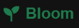

# BLOOM - Landing page --- 

This repository contains the source code of a landing page developed for **BLOOM**. The platform is designed to welcome the client, present the company, and showcase the services offered.

---

> **Project status:** completed, updates coming soon. This file is updated as the project progresses. Consult the relevant section to see the status of the latter.


## Table of Contents
- [Features](#features)
- [Technologies Used](#technologies-used)
- [How to Run the Project Locally](#how-to-run-the-project-locally)
- [Project Structure](#project-structure)
- [Architecture, Responsive Design, and Media Queries](#architecture-responsive-design-and-media-queries)
- [DOM Tree](#dom-tree)
- [How It Works](#how-it-works)
- [Code Conventions](#code-conventions)
- [Updates](#updates)
- [Created by](#created-by)


### Features

The application offers a modern and minimal interface designed to ensure a smooth and intuitive user experience. Among the main technical and interactive features, we find:

- **Dynamic Sticky Header Navigation**: The page header monitors user scrolling in real-time, modifying its style and automatically compacting when scrolling down to optimize visual space.
- **Interactive Quote Modal**: A centralized overlay system accessible via dedicated buttons (`.quote`), complete with a validated contact form (`#quoteForm`), multiple closing options (dedicated button, clicking outside, or the `Escape` key), and submission notifications.
- **Mobile-First Responsive Design**: A flexible and adaptive layout that scales seamlessly from mobile devices to desktop screens, ensuring readability and usability at any resolution.
- **Staggered CSS Animations**: Smooth transitions and waterfall entry effects (`fadeInUp`) applied to the cards in the *Works* and *Services* sections using advanced selectors and calibrated delays.
- **Dark Mode Support**: A structure prepared for color theme switching, balancing dark and light tones while highlighting the primary brand color (HSL 150, 60%, 30% green).

## Technologies Used

- **HTML5**: Semantic structuring of the user interface.
- **CSS3**: Modern styling and responsive layout.
- **JavaScript (ES6+)**: Header scrolling management, modal interactions, and contact form handling.

## How to Run the Project Locally

1. **Clone the repository**:
   ```bash
   git clone [https://github.com/lisasciacca/progetto-settimana-5](https://github.com/lisasciacca/progetto-settimana-5)

```

2. **Open the application**:
  Open the `index.html` file directly in your preferred browser or use an extension like Live Server in VS Code.

---

## Project Structure

```text
.
├── index.html          single page
├── README.md
├── READMEENG.md
├── style.css           styling
├── script.js           file containing all functionalities
└── img/
    └── logo.png        logo

```
---
## Architecture, Responsive Design, and Media Queries

The project's graphical architecture adopts a **One-page** and **Mobile-First** approach. The page dynamically adapts its appearance and layout based on the user's screen size, leveraging breakpoints defined via CSS **Media Queries**:

- **Main Breakpoints**: Optimized to handle smooth transitions between mobile devices, tablets, and desktop screens.
- **Component Adaptation**: Modifies grid layouts (such as the *Works* and *Team* sections), spacing, and typography to ensure an optimal and consistent visual experience at any resolution.

## DOM Tree

Here is a clear summary in Markdown format based on the provided DOM structure:

- **Header (`<header>`)**:
  * Contains the studio logo with a sprout icon (*Bloom*).
  * Navigation menu with links to sections (*Services*, *Layout*, *Team*, *Contact*).
  * Button to toggle Dark Mode.
- **Hero Section (`.hero`)**:
  * Welcomes users with the main title *"Transformiamo idee in design"*, a brief description of the studio, and the call-to-action button (*"Richiedi preventivo"*).
- **Works Section (`.works`)**:
  * A grid composed of 6 cards (`card`) dedicated to previews of completed projects.
- **Services Section (`.services`)**:
  * Presents the three pillars of the studio's offerings:
  * **Visual Identity** (pen icon).
  * **Web design** (display icon).
  * **Motion graphics** (film icon).
- **Team Section (`.team`)**:
  * Introduces members of the creative team (Giulia Rossi, Marco Bianchi, and Sara Verdi) with stylized profile pictures, roles, and descriptions.
- **Quote Modal (`#quoteModal`)**:
  * An overlay contact form that includes fields for name, email, service selection, message, and a submit request button.
- **Footer (`<footer>`)**:
  * Closes the page with the logo, a brief bio of the studio founded in 2026, links to social profiles (Instagram, LinkedIn, and Behance), and copyright information.
  
## How It Works

The `script.js` file handles the main dynamic interactions of the page through two main features:

1. **Dynamic Scroll Header (`scroll`)**
   - Monitors page scrolling in real-time (`window.scrollY`).
   - When the user scrolls down more than `100px`, it automatically adds the `scrolled` class to the header (`#siteHeader`), enabling compaction styles or visual transitions. If the user returns to the top, the class is removed.

2. **Modal Management (`#quoteModal`)**
   - **Opening**: Listens for clicks on all elements with the `.quote` class (via `querySelectorAll`), preventing default behavior and activating the modal by adding the `active` class to the overlay block.
   - **Multiple Closing**: Allows closing the dialog window in three different ways for a better user experience:
     - Clicking the dedicated close button (`#closeModalBtn`).
     - Clicking the external dark background (`modalOverlay`).
     - Pressing the `Escape` key on the keyboard.
   - **Form Submission (`#quoteForm`)**: Intercepts form submission, shows a confirmation message via an alert, automatically closes the modal, and resets the entered fields (`form.reset()`).

### Graphical Appearance

The application features a clean, modern, and minimal design, engineered to deliver a professional and elegant visual experience. The application is also designed to be mobile-first, with the layout adapting gracefully as screen dimensions increase.
It relies on a balanced setup of dark and light tones, placing strong emphasis on the primary brand color: an elegant, natural green (HSL 150, 60%, 30%), used for logos, highlights, and interactive states.
Backgrounds alternate between bright sections and dark blocks (`#121212`) to create pleasing visual contrast and depth across sections.
Linear, highly readable sans-serif fonts are used, featuring well-defined hierarchies (impactful titles, tracked subheadings, and descriptive texts with optimized line height for comfortable reading).

### Code Conventions

- **camelCase** and English language for everything.
- **Comments that aid in code comprehension**.

### Updates 

| Version | Description |
| :--- | :--- |
| **ver. 0** | Base files |
| **ver. 0.1** | First HTML page version added |
| **ver. 1.0** | First CSS page version added |
| **ver. 1.1** | Added some animations |
| **ver. 1.2** | Added more animations |
| **ver. 2.0** | Animations finalized |
| **ver. 2.1** | Header glitch fixed |
| **ver. 3.0** | Added contact form modal |
| **ver. 4.0** | Coming soon Dark Mode |

### Created by

| Person | Role |
| :--- | :--- |
| Lisa Irene Sciacca | README, HTML, CSS, JavaScript |
